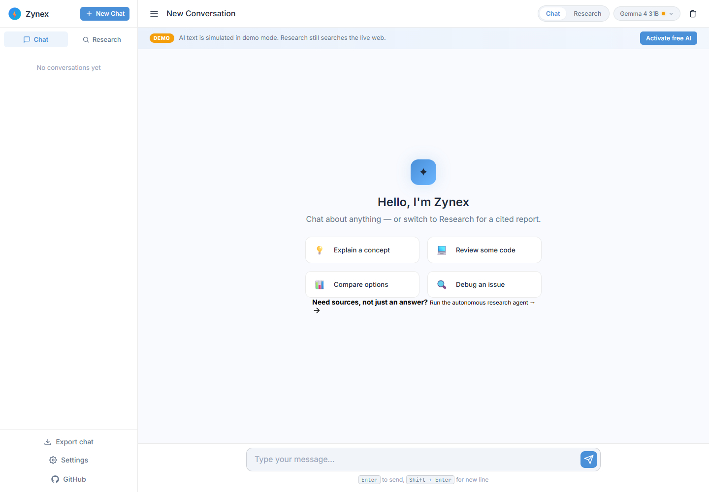
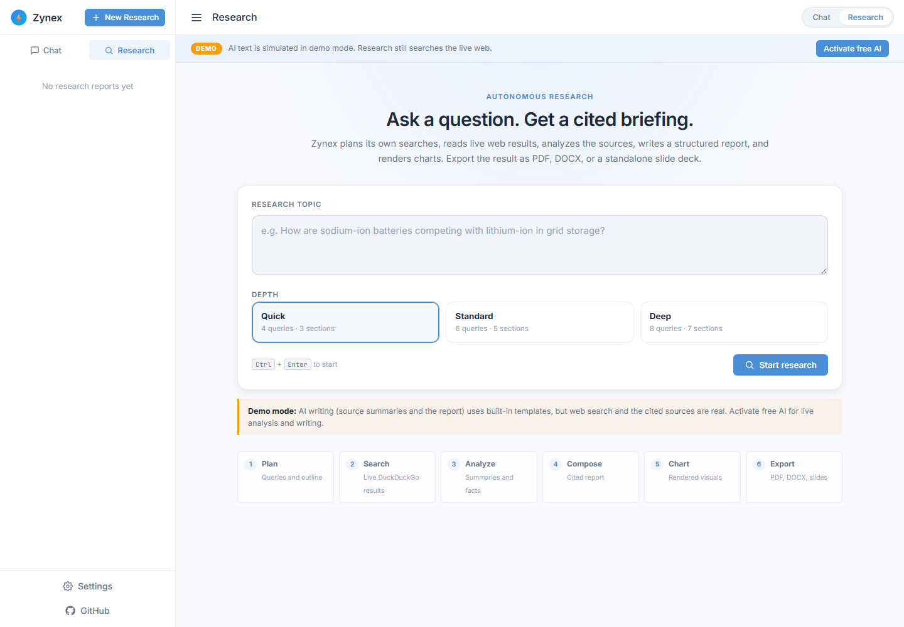
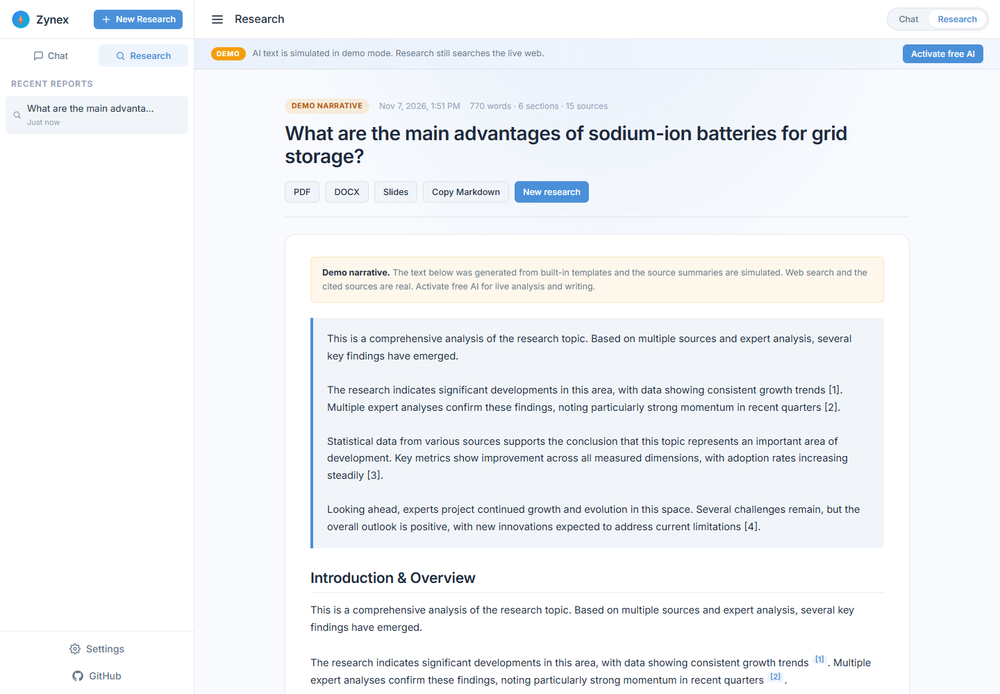
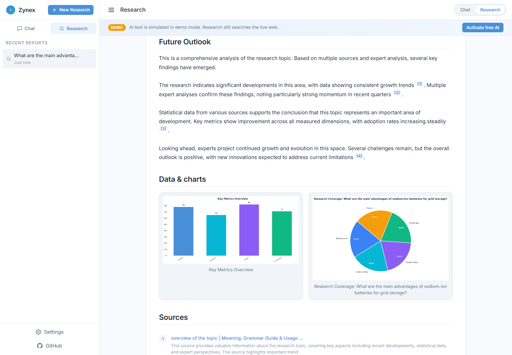

# Zynex

**Ask a question. Get a cited research report with charts — then export it as PDF, DOCX, or a slide deck.**

Zynex is a self-hosted AI research agent with streaming chat. It plans its own web searches, reads live results, writes a structured report with inline citations, renders charts, and packages the result for sharing. The frontend is dependency-free HTML/CSS/JavaScript; the backend is FastAPI.

<p align="center">
  <a href="https://github.com/ShahabAhmed01/zynex-ai/actions/workflows/ci.yml"></a>
  <a href="LICENSE"></a>
  <a href="https://www.python.org/downloads/"></a>
  <a href="https://fastapi.tiangolo.com/"></a>
</p>

## Screenshots

<p align="center">
  
</p>

| Research workspace | Cited report |
| --- | --- |
|  |  |

<p align="center">
  <br />
  <em>Charts are rendered server-side and embedded in the report and exports.</em>
</p>

## What it does

- **Streaming chat** — token-by-token responses over Server-Sent Events, with safe markdown and code-block rendering.
- **Autonomous research** — a six-stage pipeline: plan queries → search the web → analyze sources → compose a cited report → render charts → export.
- **Live sources, real citations** — searches run through DuckDuckGo (`ddgs`) and the report links to the pages that were actually found.
- **Three free models** — Gemma 4 31B (default), Nemotron 3.5 Lightning, and Nemotron 3 Ultra 550B, switchable from the header.
- **One-click activation** — provision an OpenRouter key through OAuth from the UI; no `.env` editing required.
- **Honest demo mode** — without a key, AI-written text is simulated and clearly labelled in the UI and exports. Web search and citations remain real.
- **Four export formats** — PDF, DOCX, standalone HTML slides, and copy-as-Markdown.
- **Research history** — reports are kept for the session and listed in the sidebar.
- **Responsive by default** — desktop, tablet, and mobile layouts with an accessible slide-out sidebar.

## Quick start

**Requirements:** Python 3.10+ and an internet connection (web search is live). No API key is required to start.

```bash
git clone https://github.com/ShahabAhmed01/zynex-ai.git
cd zynex-ai

python -m venv .venv
# Windows
.venv\Scripts\activate
# macOS / Linux
source .venv/bin/activate

pip install -r requirements.txt
python run.py
```

Open <http://localhost:8000>.

Zynex starts in **demo mode**. Click **Activate free AI** in the banner to provision an OpenRouter key through OAuth, or copy `.env.example` to `.env` and set `OPENROUTER_API_KEY` manually. The key is stored server-side and is never sent to the browser.

### Docker

```bash
docker build -t zynex .
docker run --rm -p 8000:8000 -e OPENROUTER_API_KEY=sk-or-v1-... zynex
```

Or with Compose:

```bash
docker compose up --build
```

The image installs the native Pango/Cairo libraries used by WeasyPrint. Outside Docker, if those libraries are missing, PDF export automatically falls back to ReportLab, so exports still work.

## Configuration

Copy `.env.example` to `.env` only if you want to configure things manually. All values are optional.

| Variable | Default | Description |
| --- | --- | --- |
| `OPENROUTER_API_KEY` | empty | OpenRouter key. Empty means demo mode. |
| `DEFAULT_MODEL` | `google/gemma-4-31b-it:free` | Model used when the UI does not specify one. |
| `MAX_TOKENS` | `4096` | Maximum output tokens per LLM request. |
| `HOST` | `0.0.0.0` | Bind address. |
| `PORT` | `8000` | HTTP port. |
| `RELOAD` | `true` in `run.py` | Set `false` in production. |
| `CORS_ORIGINS` | localhost origins | Comma-separated origins for a separately hosted frontend. |

The model menu is populated from the backend, so verified free models stay in sync with `backend/config.py`. Paid OpenRouter models can be used by setting `DEFAULT_MODEL` directly.

## How research works

```text
Topic + depth
    │
    ▼
1. Query planner ......... 4–8 search queries + report outline
    │
    ▼
2. Web researcher ........ DuckDuckGo via ddgs, deduplicated sources
    │
    ▼
3. Source analyzer ....... key facts and relevance per source
    │
    ▼
4. Report composer ....... summary + sections with inline [n] citations
    │
    ▼
5. Chart generator ....... up to 4 light-theme charts (PNG)
    │
    ▼
6. Export engine ......... PDF / DOCX / HTML slides
```

Progress streams to the browser over SSE, with JSON polling as a fallback. Every job gets a random `access_token`; status, report, and export endpoints require it.

Depth controls the amount of work:

| Depth | Queries | Sections | Typical use |
| --- | ---: | ---: | --- |
| Quick | 4 | 3 | A fast briefing |
| Standard | 6 | 5 | Default research run |
| Deep | 8 | 7 | Broad coverage |

> **Operational note:** research jobs are stored in memory and expire after two hours. Run a single Uvicorn worker unless you add a shared queue or database.

## API

All endpoints are prefixed with `/api`. Interactive docs are available at `/docs`.

| Method | Endpoint | Description |
| --- | --- | --- |
| `POST` | `/chat` | Stream a chat completion (SSE). Rate limit: 20/min. |
| `POST` | `/research` | Start a research job. Returns `job_id` and `access_token`. Rate limit: 5/min. |
| `GET` | `/research/{job_id}/status?token=…` | Stream progress events (SSE). |
| `GET` | `/research/{job_id}/poll?token=…` | Poll job status as JSON. |
| `GET` | `/research/{job_id}/report?token=…` | Fetch the completed report. |
| `GET` | `/research/{job_id}/export/pdf?token=…` | Download a PDF. |
| `GET` | `/research/{job_id}/export/docx?token=…` | Download a DOCX. |
| `GET` | `/research/{job_id}/export/slides?token=…` | Download a standalone HTML slide deck. |
| `GET` | `/health` | Liveness and non-secret runtime summary. |
| `GET` | `/health/llm?verify=true` | Optionally ping OpenRouter with the configured key. |
| `GET` | `/config` | Demo state, model list, token limit, and version. |
| `GET` | `/auth/url?callback_url=…` | Build the OpenRouter OAuth URL. |
| `POST` | `/auth/callback` | Exchange an OAuth code and store the key server-side. |

A minimal research flow:

```bash
curl -s -X POST http://localhost:8000/api/research \
  -H "Content-Type: application/json" \
  -d '{"topic":"sodium-ion batteries for grid storage","depth":"quick"}'
```

Use the returned `job_id` and `access_token` on the status/report endpoints.

## Development

```bash
pip install -r requirements-dev.txt

# Lint
ruff check backend tests scripts

# Unit and API tests
pytest -q

# Six-stage pipeline in demo mode
python scripts/test_pipeline.py

# HTTP end-to-end test (start the server first)
python scripts/test_api_e2e.py http://127.0.0.1:8000
```

The pytest suite covers API contracts, input validation, token enforcement, report schemas, the PDF fallback, DOCX/slides output, and LLM error handling. CI runs lint and tests on Python 3.10–3.14, then runs the pipeline end to end.

### Project layout

```text
backend/
  agents/        query planner, researcher, analyzer, composer, charts, exports
  middleware/    rate limiting, request IDs
  models/        Pydantic schemas
  routes/        chat, research, auth, health
  services/      OpenRouter client, streaming chat, DuckDuckGo search
  templates/     report and slide templates
frontend/
  css/           design tokens and component styles
  js/            chat, research, markdown, streaming, config, storage
tests/           pytest suite
docs/            architecture, deployment, and launch notes
scripts/         pipeline and HTTP end-to-end checks
```

## Architecture

```text
Browser (HTML + CSS + ES modules)
   │  POST /api/chat · POST /api/research · SSE progress
   ▼
FastAPI
   ├─ routes/       chat, research, auth, health
   ├─ services/     OpenRouter (OpenAI SDK), ddgs search
   ├─ agents/       six-stage research pipeline
   └─ templates/    Jinja2 report + slides, ReportLab PDF fallback
   │
   ├──────────────► OpenRouter (LLM inference)
   └──────────────► DuckDuckGo (live web results)
```

See [`docs/ARCHITECTURE.md`](docs/ARCHITECTURE.md) for the job lifecycle, security model, and failure behavior.

## Security

- Research job data is protected by per-job access tokens compared in constant time.
- Chat, research, and auth endpoints are rate-limited.
- Requests and topics are validated and length-capped before reaching an LLM or search provider.
- Responses set CSP, `X-Frame-Options: DENY`, `nosniff`, and a restrictive referrer policy.
- API keys are stored server-side in `.env` and are never returned by `/api/config` or `/api/health`.
- In live mode, LLM failures are surfaced as errors; Zynex does not silently replace them with template text.

Please report vulnerabilities privately via [GitHub Security Advisories](https://github.com/ShahabAhmed01/zynex-ai/security/advisories/new). See [`SECURITY.md`](SECURITY.md).

## Contributing

Issues and focused pull requests are welcome. Start with [`CONTRIBUTING.md`](CONTRIBUTING.md) and the issue templates. By participating, you agree to the [`CODE_OF_CONDUCT.md`](CODE_OF_CONDUCT.md).

## License

MIT — see [`LICENSE`](LICENSE).

```text
Copyright (c) 2026 Shahab Ahmed
```
